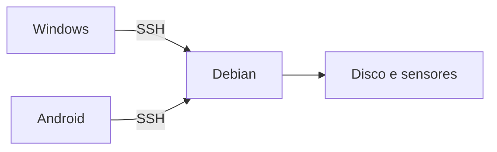

# NAN STORAGE

**01 · Infraestrutura Linux em hardware reaproveitado · Novembro de 2026**

[Voltar ao portfólio](../README.md)

## Problema

Investigar o reaproveitamento de um notebook próprio como nó Linux de baixo custo, verificando instalação, conectividade e diagnóstico antes de implantar serviços de armazenamento.

## Minha participação

Preparei mídia, instalei Debian 13 sem interface gráfica, executei comandos orientados e testei acesso SSH por Windows e Android. A investigação e a interpretação das saídas foram realizadas com apoio de IA; não reivindico administração autônoma de servidores empresariais.

## Método e resultados

| Verificação | Evidência registrada | Limite |
| --- | --- | --- |
| Mídia de instalação | SHA-256 conferido após correção de divergência de cópia | Assinatura OpenPGP não verificada |
| Sistema e acesso | Debian 13 instalado; SSH por Windows e Android | Verificação da chave do host pendente |
| Rede | Acesso por Wi-Fi após reinicialização sem Ethernet | Não comprova segurança da rede |
| Disco | SMART inicial PASSED, sem setores realocados, pendentes ou incorrigíveis reportados | Autoteste não executado |
| Alimentação | Incerteza elétrica identificada; bancada suspensa | Operação prolongada não autorizada |

## Arquitetura conceitual

## Aprendizados e próximos passos

Integridade de arquivos, conectividade e disponibilidade de serviços exigem verificações distintas. SMART não substitui backup. A bancada permanece condicionada à segurança elétrica; Samba, restauração de backup e operação contínua não foram demonstrados.

Referências: [Debian](https://www.debian.org/) · [OpenSSH](https://www.openssh.com/) · [smartmontools](https://www.smartmontools.org/)

*Laboratório pessoal guiado, síntese de registros históricos. Nenhum teste novo foi executado para esta edição.*
