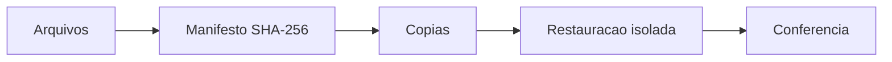

# NAN SYSTEM

**03 · Proteção de dados e recuperação verificável · Novembro de 2026**

[Voltar ao portfólio](../README.md)

## Problema

Organizar projetos pessoais e proteger dados em armazenamento portátil, verificando cópias, integridade e recuperação em escopos definidos.

## Minha participação

Defini objetivos e requisitos, autorizei operações, configurei BitLocker To Go sob orientação e confirmei desbloqueio e recuperação em privado. Agentes de IA implementaram rotinas, manifestos e painel documental; a auditoria assistida reproduziu verificações selecionadas.

## Resultados históricos

| Verificação | Resultado | Origem |
| --- | --- | --- |
| Proteção e recuperação do volume | Configuração e desbloqueio confirmados | Operação guiada e confirmação do operador |
| Snapshots | Cinco snapshots; 143 arquivos de conteúdo conferidos | Auditoria assistida por IA |
| Restauração de recorte | 44 arquivos restaurados | Auditoria em ambiente isolado |
| Painel | 60 arquivos de snapshot e 55 hashes de instalação conferidos | Auditoria assistida |
| Testes Node.js | 15 de 15 reproduzidos | Auditoria assistida |

## Aprendizados e limites

Criptografia não substitui backup; criar uma cópia não comprova sua restauração. Hash verifica integridade em relação a uma referência confiável. Os números acima não demonstram cobertura integral da regra 3-2-1, recuperação de todos os projetos ou disponibilidade contínua. Nenhum segredo, manifesto bruto ou caminho privado é publicado.

Referências: [Microsoft Learn — BitLocker](https://learn.microsoft.com/windows/security/operating-system-security/data-protection/bitlocker/) · [NIST — SHA](https://csrc.nist.gov/projects/hash-functions)

*Projeto pessoal com engenharia assistida por IA; não reivindico autoria autônoma das implementações.*
